# pdf-triage

pdf-triage reads PDF files without rendering or executing them and lists the features that matter in phishing and malware triage: JavaScript, automatic actions on open, launch actions, embedded files, form submission, legacy attack surface such as XFA and RichMedia, names hidden with hex escapes (`/J#61vaScript`), and files with several incremental updates or data after the last `%%EOF`. Every finding says what to look at next.



**Live demo:** https://jvch0512.github.io/pdf-triage/ (Hand-written minimal PDFs, no real malware.)

C++17, standard library only. The demo page is rendered from the tool's `--tsv` output by `scripts/site.py` (Python 3, only needed to regenerate the page).

## Use

```bash
make
./pdf-triage examples
./pdf-triage invoice.pdf --tsv
./pdf-triage ./mail-attachments --fail-on high      # exit 1 if any PDF has active content
```

Pass a file or a directory (searched recursively for `.pdf`).

| Rule | Severity | What it catches |
|---|---|---|
| PDF001 | high | `/JavaScript` or `/JS`: script that runs in the viewer |
| PDF002 | high | `/Launch`: starts a program or opens a file |
| PDF003 | high or medium | `/OpenAction` or `/AA` (runs on open or on events); high when combined with script or launch |
| PDF004 | medium | `/EmbeddedFile`: a file carried inside the PDF |
| PDF005 | medium | `/URI` references (counted) and `/SubmitForm` |
| PDF006 | high | risky names written with `#xx` escapes to dodge simple scanners |
| PDF007 | medium | `/XFA`, `/RichMedia`, `/3D`: legacy viewer attack surface |
| PDF008 | low | `/Encrypt`, several `%%EOF` markers (incremental updates), data after the last `%%EOF` |
| PDF009 | low | object streams: dictionaries inside compressed streams are not visible to this tool |
| PDF000 | info | not a PDF |

See [examples](examples) and [docs/sample-output.txt](docs/sample-output.txt).

## Limits

- No decompression. Anything that lives inside a compressed object stream is not seen, and PDF009 says when that blind spot exists.
- Strings and stream bodies are skipped, so names that only appear as text are not counted.
- It reports capabilities, not intent. Many legitimate PDFs have forms, links and JavaScript for validation.
- It does not extract or decode payloads. Use a PDF analysis suite for that, with a sandbox.

## Where it fits

Mail security triage and incident response: a safe first look at suspicious attachments that tells an analyst whether to escalate or release.

## Tests

```bash
make test    # 65 checks
```

MIT.

## Code scanning (SARIF)

`scripts/tsv2sarif.py` converts the `--tsv` output into SARIF 2.1.0, so findings show up in GitHub code scanning:

```sh
./pdf-triage examples --tsv | python3 scripts/tsv2sarif.py --tool pdf-triage --prefix examples > results.sarif
```

Upload `results.sarif` with `github/codeql-action/upload-sarif`. Severities map to SARIF levels (critical and high to error, medium to warning, low and info to note) and to a `security-severity` score.
